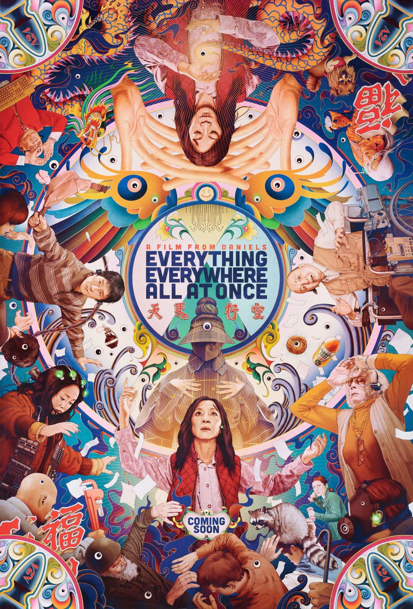

## Welcome

- IWB
- ISSA
- [DISplay](https://dalu.sharepoint.com/teams/DISParty/Shared%20Documents/General/The%20Department%20of%20Information%20Science%20presents....pdf)!

## Some rules

- Be respectful
- There are no stupid comments or questions
- The prof is not always right
- Have fun!

## I say information you say...

## 

{width="550"}

## Live survey

<https://www.menti.com/?code=33811514>

## Schedule {.scrollable .smaller}

+--------+----------------------------------------------------------+----------------------------------------------+
| Date   | Theme/reading to complete before class                   | Class activities                             |
+:======:+==========================================================+==============================================+
| Sep 14 | Chapter 1. The Information Field                         | Introduction\                                |
|        |                                                          | Course overview                              |
+--------+----------------------------------------------------------+----------------------------------------------+
| Sep 21 | Chapter 2. What is Information?                          | Short lecture\                               |
|        |                                                          | group exercise                               |
+--------+----------------------------------------------------------+----------------------------------------------+
| Sep 28 | Chapter 3. Information Issues                            | Guest lecture by Dr. Jennifer Grek-Martin    |
+--------+----------------------------------------------------------+----------------------------------------------+
| Oct 5  | Chapter 10. Information and Democracy                    | Guest lecture by Dr. Jason Hannan            |
+--------+----------------------------------------------------------+----------------------------------------------+
| Oct 19 | Chapter 5. Work in the Information Society\              | Guest lecture by Kellie Dalton               |
|        | Chapter 6. Information in Organizations                  |                                              |
+--------+----------------------------------------------------------+----------------------------------------------+
| Oct 26 | Chapter 7. The Information Economy                       | Guest lecture by Dan Philips                 |
+--------+----------------------------------------------------------+----------------------------------------------+
| Nov 2  | Chapter 4. Humans in an Information Society\             | Short lecture + group discussions            |
|        | Chapter 8. The Attention Economy                         |                                              |
+--------+----------------------------------------------------------+----------------------------------------------+
| Nov 16 | Chapter 11. Information Justice                          | Guest lecture by Alison Brown                |
+--------+----------------------------------------------------------+----------------------------------------------+
| Nov 23 | TBD                                                      | Guest lecture by Maddie Hare and Janet Music |
+--------+----------------------------------------------------------+----------------------------------------------+
| Nov 30 | Chapter 9. Misinformation, Disinformation, and Fake News | Short lecture\                               |
|        |                                                          | group exercise                               |
+--------+----------------------------------------------------------+----------------------------------------------+
| Dec 7  | TBD                                                      | Guest lecture by Coel Conrad                 |
+--------+----------------------------------------------------------+----------------------------------------------+
| Dec 8  | N/A                                                      | Fun.                                         |
+--------+----------------------------------------------------------+----------------------------------------------+

## Assignments {.smaller}

| Assignment                             | Due date                   | Weight |
|----------------------------------------|----------------------------|--------|
| Participation self-assessment - Part 1 | Friday, September 25, 2025 | 7.5%   |
| Analysis of an information setting     | Friday, October 16, 2026   | 30%    |
| Participation self-assessment - Part 2 | Friday, October 30, 2026   | 5%     |
| Essay plan                             | Friday, October 30, 2026   | 10%    |
| Essay                                  | Friday, December 11, 2026  | 40%    |
| Participation self-assessment - Part 3 | Friday, December 11, 2026  | 7.5%   |

## Doing the math {.smaller}

\*\*3-credit course\*\* 9hrs/week = 3hrs/week of class time + 6hrs/week for the rest.

\*\*This semester\*\* 6 hours x 12 weeks = 72 hours.

\*\*This course\*\* Class prep \~ 12 hours\
Participation self-assessment \~ 1 hours\
Assignment #1 - Information Setting \~ 12 hours\
Assignment #2 - Essay plan \~ 5 hours\
Assignment #3 - Essay \~ 42 hours
