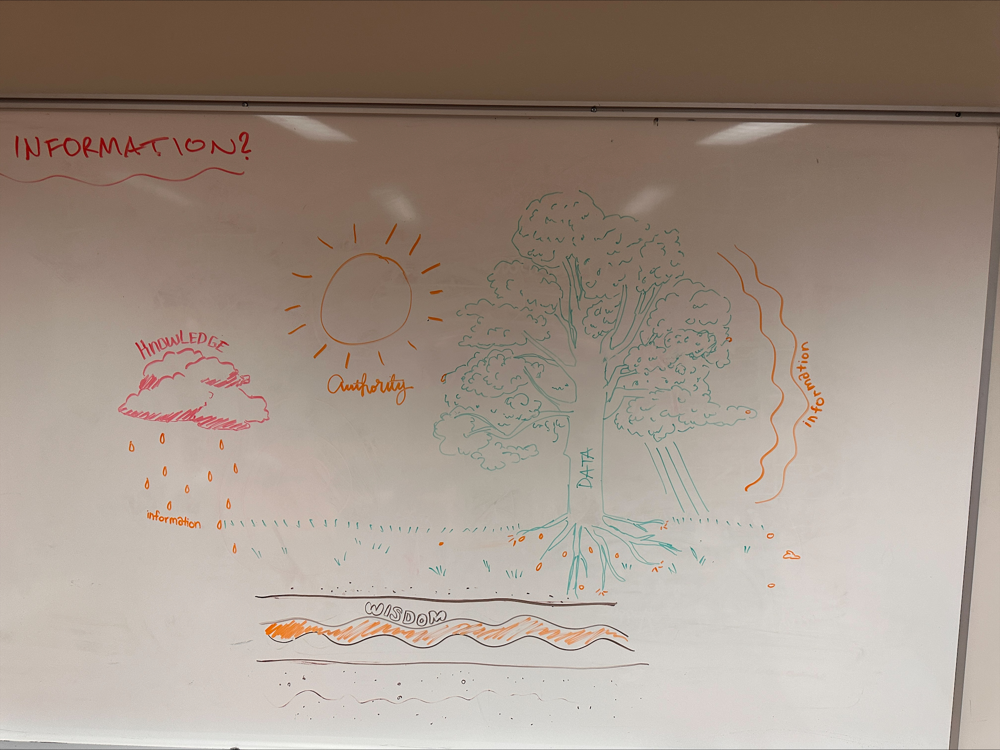
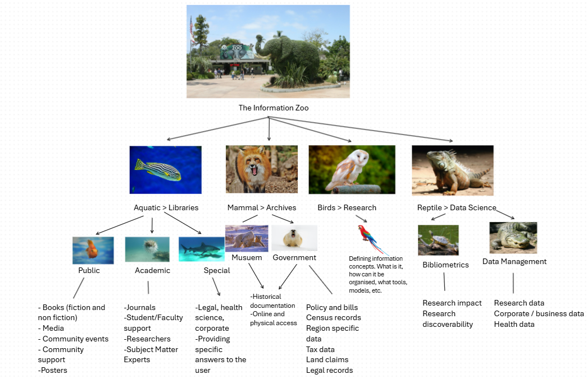

## Today's plan {.smaller}

- Remaining presentations from last week
- Very short presentation
- Group discussions

# Remaining presentations

## Types of information issues {.smaller}

- Access
- Quantity
- Quality
- Behaviour

The goal is to provide a general, high-level framework that can apply most or all scenarios.

# Group discussions {.smaller}

- **Time**: Until 5:00 pm
- **Rules**: be kind, respectful, and inclusive.

## Questions {.smaller}

- Do you think other types of information issues should be added to my list?
- How do you think technologies can help or accentuate information access issues?
- Have you ever experienced information overload in a work or school context?
- What factors do you believe contribute to information overload in these settings?
- What strategies did you or others use to reduce or cope with the information overload?
- What barriers prevented you from getting the information you needed in a work or school context?
- Are the information issues that people experience at work natural phenomena?
- What are the implications of your answer to that question when seeking solutions to the information issues we experience?
- Do you find communicating easier in smaller team environments than in larger ones? How do communication processes change based on the size of the group? How are our environments influenced based on information processes?
- Consider the Data-Information-Knowledge-Wisdom pyramid. Does it seem relevant to the organizations you have worked in? How could you reimagine it based on the flow of information and knowledge exchange in the organizations you have been a part of?

## Teams {.smaller .scrollable}

```{r echo=FALSE, message=FALSE, warning=FALSE}
library(tidyverse)
library(readxl)
library(DT)

x<-read_xlsx("../files/teams.xlsx") %>%
  filter(Week == "Week 5") %>%  
  select(Name = first, Team = team) %>% 
  arrange(Team)

DT::datatable(x, rownames = F,
              filter = "top",
              options = list(
                pageLength = 8,
                columnDefs = list(
                  list(width = '10px', targets = 0),
                  list(className = 'dt-center', targets = 0),
                  list(width = '400px', targets = 1))
              )
)
```

# Poster

## 

{fig-align="center"}

## 

{fig-align="center"}
